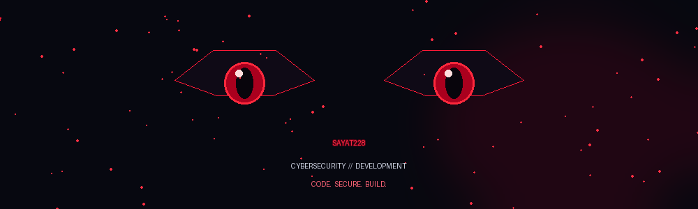

# SAYAT228

### `CYBERSECURITY` · `DEVELOPMENT` · `CTF`

*Code. Secure. Build.*

---

## `01` — WHOAMI

🎓 Student | Cybersecurity enthusiast

- 🔐 Learning information security and networking
- 🧩 Practicing CTF challenges
- 💻 Building projects and improving development skills
- 🎯 Goal: become a strong cybersecurity engineer

## `02` — CURRENT STATUS

| Field | Status |
|---|---|
| Learning | Cybersecurity & networking |
| Practice | CTF challenges |
| Development | Personal projects |
| Mission | Learn. Build. Improve. |

## `03` — TECH STACK

  

## `04` — GITHUB STATISTICS

## `05` — FEATURED PROJECTS

- [sayat-wiki](https://github.com/sayat228/sayat-wiki)
- [url-shortener](https://github.com/sayat228/url-shortener)
- [go-tasks-it-club](https://github.com/sayat228/go-tasks-it-club)

---

`DISCIPLINE BUILDS FREEDOM`

**Thanks for visiting my profile.** 🔴

